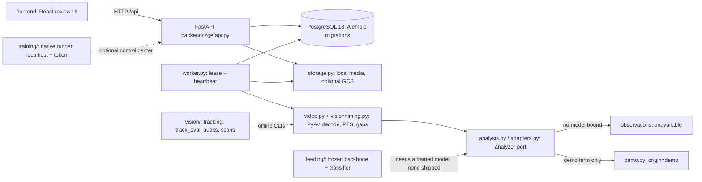

# Architecture (English summary)

The authoritative, detailed design is in [ARCHITECTURE.md](ARCHITECTURE.md) (Turkish). This page summarises what is implemented.

Solid edges are exercised by tests; dashed edges are code that is optional, offline, or needs a trained model.

## Design rules that matter to contributors

- Result origins `manual`, `model`, `demo`, `unavailable` are never mixed. Demo output only appears on a demo farm.
- Time comes from presentation timestamps (PTS). Nominal FPS is never used to fill gaps; unknown time stays unknown.
- Manual review never rewrites automatic durations; corrections are new records.
- Worker writes are fenced by a lease token and deadline.
- `backend/izge/schema_v1.py` is the frozen first-migration schema; schema changes need a new Alembic migration.
- The domain layer does not import ORM, HTTP or video libraries.

## Reusable pieces

| Module | What it does | Tests |
|---|---|---|
| `vision/tracking.py` | ByteTrack-style IoU tracker | 100% line coverage |
| `vision/track_eval.py` | CLEAR-MOT, IDF1, HOTA | 97%; hand-computed regression test |
| `vision/timing.py` | PTS sampling and source-gap accounting | 98% |
| `vision/annotation_audit.py` | COCO-style annotation sanity checks | 97% |
| `vision/frame_quality.py` | Frame appearance and quality scan | 97% |
